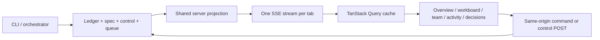

# Live panel architecture

The panel is a React 19 + TypeScript application built with Vite and Tailwind CSS.
Fonts are bundled locally. The production Node server serves the built assets;
there is no CDN dependency or separate frontend service in Docker.

## Ownership

- Core owns ledger validation, transitions, budget math, and queue semantics.
- `snapshot.ts` makes one ledger read for state, budget, agent activity, and the
  latest 200 events. It enriches tasks from the matching recorded spec version.
- `PanelStream` owns one shared file reconciliation pump per panel server.
- TanStack Query owns the single authoritative browser snapshot cache.
- Zustand owns screen, filter, search, drawer, draft note, and connection UI state.
  It does not store another copy of tasks, agents, budgets, or commands.



## Streaming and recovery

`GET /api/stream` sends named `snapshot` events, with `id: serverEpoch:revision`,
a schema version, a monotonic revision within that epoch, and an updated time.
File watches debounce changes for 35 ms. A one-second reconciliation timer
covers missed notifications, unavailable watches, and directory replacement.
The browser does not poll each screen separately.

A connection always begins with a complete, authoritative snapshot. On reconnect,
the current snapshot replaces the cache even if Last-Event-ID is old or from a
previous server. This is full resynchronization rather than delta replay: no
missing intermediate delta is needed to rebuild the current view. Repeated or
older snapshots from the same server are ignored. Mutations are never replayed
by the transport. `GET /api/snapshot` exposes the same projection to other clients.

Heartbeats run every ten seconds. Reconnect/stale states keep the previous data
visible and disable mutations. Data-read errors are distinct from transport
heartbeats. SSE automatically retries; a heartbeat timeout recreates a stalled
connection. Old connection callbacks cannot replace a newer connection's state.
Slow consumers reconnect instead of retaining an unbounded output buffer. Server
shutdown closes SSE clients and all watchers/timers.

Every ledger change currently replays the ledger in full. This is intended for
local prototype runs; large-ledger indexing/incremental projection is future work.
The activity screen explicitly labels its latest-200-event window.

## Operator actions

Notes, answers, and checkpoint resolutions use the durable command queue. A
successful POST means queued, not applied. Questions/checkpoints remain visible
until the orchestrator records their effect. Queue acknowledgments stream even
when no new ledger event exists. Consumers must reconcile command_seq against
the ledger and acknowledge only the applied prefix; see execution-hardening.md.

Pause, resume, and stop update the control file. Requested controls and ledger
pause state are shown separately. Stop does not kill running OS processes.
Requests are not retried automatically. Errors retain the user's draft.

The panel remains unauthenticated and local-only. The HTTP layer rejects
non-local Host headers and cross-origin mutations, serves only built asset
paths, and includes a self-hosted content security policy. Keep the Compose
loopback port binding. Production publication/authentication is separate work.

## What an agent status means

Agent cards describe work and lifecycle events in the ledger, not process or
provider liveness. Model tiers and purposes are shown only when the recorded
spec can supply them. Missing metrics are not fabricated. Recorded Docker demo
data is labeled and no AI agent starts with the panel.

## Development

```sh
npm ci
npm run build
npm run -s clockwork -- ui --port 47831
# In another terminal:
npm run panel:dev
```

Vite uses port 47832 and proxies `/api` to the local API on 47831, including SSE.
`npm run check` typechecks server/client, builds the UI, runs tests, and checks
public files. Integration tests exercise real external CLI writes, multiple
subscribers, controls, queue acknowledgment, and reconnect/server-restart resync.
